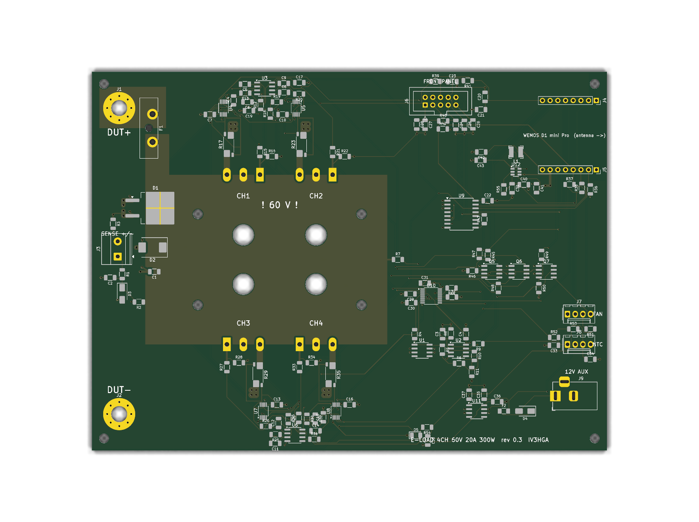
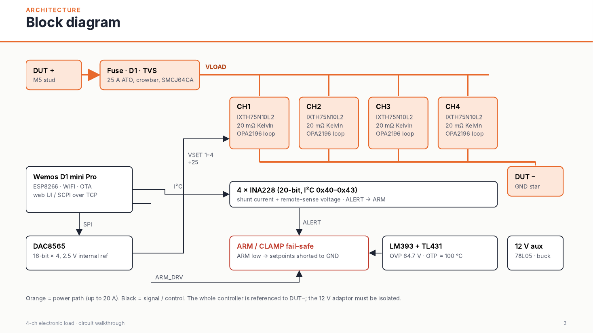
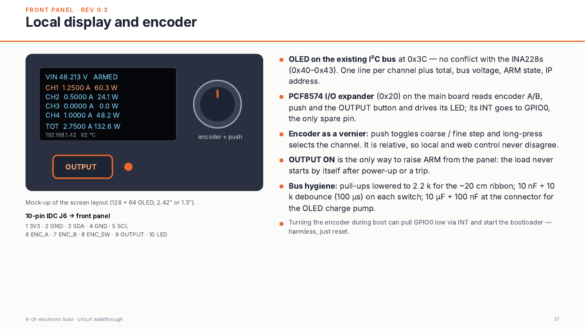
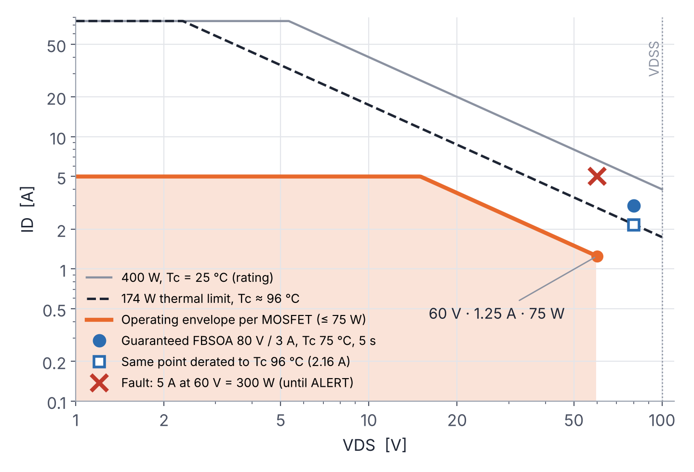
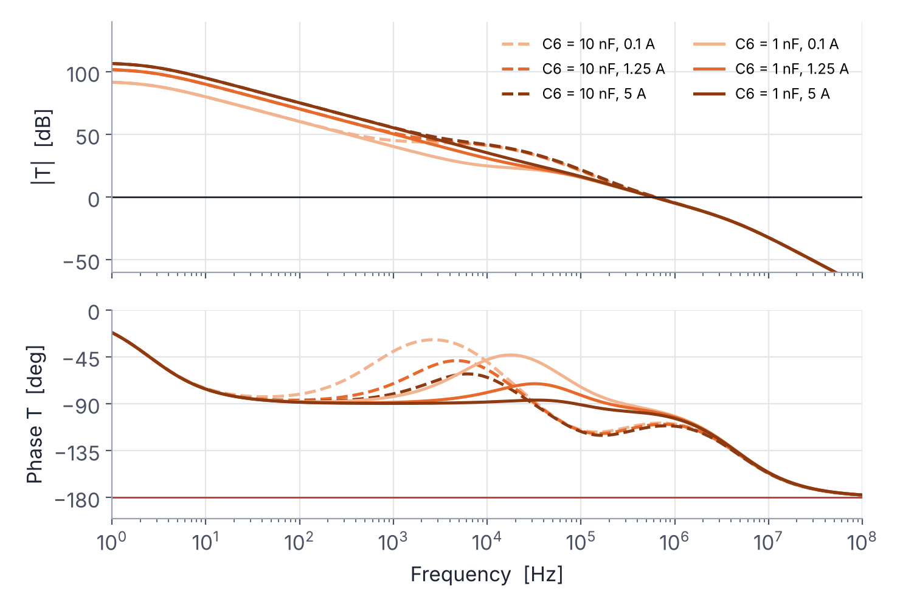

# eload-60v — 4-channel electronic load, 60 V · 20 A · 300 W

An open-hardware DC electronic load with four independent constant-current channels, 20-bit measurement on every channel, a hardware fail-safe that does not depend on firmware, and WiFi control through a plug-in ESP8266 module.



> **Status: rev 0.3 — design complete, not yet built or bench-tested.**
> ERC and DRC (with schematic parity) are clean, and the control loop and thermal budget have been analysed numerically. Treat it as a reviewed design, not a proven product. Bench reports, issues and pull requests are very welcome.

## Specifications

| Parameter | Value |
|---|---|
| Input voltage | 0 – 60 V (hardware OVP trips at 64.7 V) |
| Current | 4 channels × 0 – 5 A = 20 A |
| Power | 4 × 75 W = 300 W continuous (power-limited above 15 V) |
| Mode | Constant current per channel; CP / CR in firmware |
| Setpoint | DAC8565, 16 bit → 76 µA per LSB per channel |
| Measurement | INA228 per channel: 20-bit, Kelvin shunt, remote voltage sense |
| Control | WiFi, Wemos LOLIN D1 mini Pro (ESP8266) on sockets; front panel with I²C OLED, encoder and OUTPUT button |
| Protection | OVP, OTP, per-channel over-current/over-power ALERT, reverse-polarity crowbar, 25 A fuse |
| Loop | Phase margin ≈ 80°, closed-loop bandwidth 6 – 15 kHz (model) |
| PCB | 170 × 125 mm, 2 layers, 2 oz copper, KiCad 10 |

## How it works



- **Power path.** DUT+ → 25 A ATO fuse → VLOAD bus. A D²PAK Schottky (VS-30CTQ100S) acts as a reverse-polarity crowbar that blows the fuse, and an SMCJ64CA TVS clamps transients.
- **Channels.** Each channel is an OPA2196 integrator driving an IXYS **IXTH75N10L2** *Linear L2* MOSFET (extended FBSOA, designed for linear operation) with a 20 mΩ 4-terminal shunt (Vishay WSK2512). The setpoint is the DAC output divided by 25, referenced to the shunt's cold Kelvin pad: **I = V_DAC × 2 A/V**.
- **Measurement.** One INA228 per channel reads the shunt (Kelvin) and the remote-sense voltage. Its ALERT pin is wired to the common ARM line, so a programmed over-current or over-power limit shuts the load down in hardware.
- **Fail-safe.** ARM is active-high with a pull-down. It can be pulled low by the MCU, by the LM393 OVP/OTP comparators or by any INA228 ALERT. ARM low drives CLAMP high, which shorts all four setpoints to ground. No MCU, a reset or a boot glitch all leave the load off.
- **Thermal.** The four TO-247 parts are mounted *under* the PCB on an 80 × 70 × 6 mm copper spreader. The spreader sits at VLOAD (drain) potential, so it is isolated from an SP3/TR4-class CPU cooler by a thermal pad. Two NTC thermistors sit on the spreader.
- **Front panel (rev 0.3).** A 10-pin IDC connector carries the I²C bus to a 128 × 64 OLED (0x3C) and the encoder, its push switch, the OUTPUT button and its LED to a PCF8574 expander (0x20) on the main board. The expander's INT goes to GPIO0. The encoder works as a vernier: push toggles coarse/fine, long-press selects the channel. OUTPUT ON is the only way to arm the load from the panel.
- **Supplies.** An isolated 12 V adaptor feeds the op-amps and the fan. A 78L05 supplies the analog 5 V (DAC, comparators). A separate AP63205 buck feeds only the WiFi module, and its 3.3 V regulator powers the logic.



The full walkthrough, including SOA, thermal budget and loop-stability analysis, is in **[docs/Electronic_Load_Circuit_Walkthrough.pdf](docs/Electronic_Load_Circuit_Walkthrough.pdf)** (20 slides).

## Analysis highlights

| SOA | Loop gain |
|---|---|
|  |  |

- **SOA.** The worst steady point is 60 V × 1.25 A = 75 W per MOSFET. The guaranteed FBSOA (240 W at 80 V, T<sub>C</sub> 75 °C), derated to T<sub>C</sub> ≈ 96 °C, gives ≈ 173 W, a **2.3× margin**.
- **Thermal.** T<sub>J</sub> ≈ 119 °C at 35 °C ambient with a 0.12 K/W cooler. At the OTP trip point (spreader ~100 °C) T<sub>J</sub> ≈ 139 °C. To run 300 W continuously the cooler plus pad must be ≤ 0.22 K/W.
- **Loop.** Rev 0.1 used 10 nF compensation: stable, but only 0.6 – 1.5 kHz bandwidth and a turn-on delay of about 2 ms. **Rev 0.2 uses C6 = 1 nF and C5 = 10 nF:** PM ≈ 80°, 6 – 15 kHz, about 28 µs for small steps. A 10 mA keep-alive in firmware cuts the turn-on from the clamp to about 39 µs.

The model and scripts are in [`analysis/`](analysis/). Op-amp second pole and output resistance, the cooler's thermal resistance and the pad are **assumptions**, listed in the slides.

## Repository layout

```
hardware/
  kicad/          KiCad 10 project (eload_4ch.kicad_pro), custom symbols, DRC rules
  fabrication/    Gerbers + drill (zip) and pick-and-place positions, rev 0.3
  bom/            BOM from KiCad (CSV) and priced BOM with sources (XLSX)
docs/
  Electronic_Load_Circuit_Walkthrough.pdf   slide deck (English)
  eload_4ch_schematic.pdf, eload_4ch_pcb.pdf
  images/, reports/ (ERC / DRC)
analysis/         loop model (sympy/scipy), large-signal sim, SOA/thermal plots
tools/generator/  Python scripts that generated the schematic and placed/routed the PCB
```

Schematic, PCB and the KiCad BOM are in English. The priced BOM workbook (`eload_4ch_bom_priced.xlsx`) and the code comments in `tools/` are still in Italian.

## Building one

1. **PCB.** Use `hardware/fabrication/eload_4ch_gerbers_rev0.3.zip`: 2 layers, 1.6 mm, **2 oz** copper. Many fabs require ≥ 0.2 mm spacing with 2 oz copper, while the INA228 MSOP-10 pads are 0.15 mm apart (the project has a local DRC exception for them). Confirm with your fab, or order 1 oz outer layers.
2. **Parts.** See `hardware/bom/eload_4ch_bom_priced.xlsx`. The electronics cost is about €126 per board at single quantities (October 2026). The four IXTH75N10L2 are about half of that and can have long factory lead times.
3. **Mechanics and front panel.** Copper spreader, insulating thermal pad (≥ 100 V), CPU cooler with a 4-wire PWM fan, M3 nylon standoffs, M5 bolts for the DUT studs. Front panel: 2.42″ SSD1309 or 1.3″ SH1106 I²C OLED, EC11 encoder with push, OUTPUT button with LED, 10-wire ribbon (≤ 20 cm). J6 pinout: 1 3V3 · 2 GND · 3 SDA · 4 GND · 5 SCL · 6 ENC_A · 7 ENC_B · 8 ENC_SW · 9 OUTPUT · 10 LED (cathode, 470 Ω on board).
4. **Firmware.** Not written yet. Pin map for the D1 mini Pro:

| Pin | GPIO | Function |
|---|---|---|
| D1 / D2 | 5 / 4 | I²C SCL / SDA → INA228 0x40 – 0x43, PCF8574 0x20, OLED 0x3C |
| D5 / D7 / D8 | 14 / 13 / 15 | SPI SCK / MOSI / SYNC → DAC8565 |
| D6 | 12 | ARM_DRV (quiet at boot) — re-assign as output after `SPI.begin()` |
| D0 | 16 | ARM_FB read-back (100 k) |
| D3 | 0 | PCF8574 INT (front panel) |
| D4 | 2 | Fan PWM |
| RX | 3 | Fan tach |
| A0 | — | NTC1 |

## ⚠️ Safety

- The whole controller, including the Wemos USB port, is referenced to **DUT−**. **USB is not isolated:** only program the module with the DUT disconnected, then update over the air. The 12 V adaptor must be isolated.
- The copper spreader and the MOSFET tabs are **live at the DUT voltage**.
- 300 W of heat is real. Do not run full power without the cooler and fan, and verify the OTP before trusting it.

## To verify on the bench

- Loop step response (1.0 ↔ 1.2 A) into a stiff supply, then with 1 m of DUT cable.
- D1 crowbar surviving the fuse I²t on reversed connection.
- Thermal resistance of the actual cooler and pad; OTP trip point.
- WiFi range with the antenna overhanging the board edge inside the enclosure.
- I²C signal integrity with the OLED on a 20 cm ribbon (2.2 kΩ pull-ups).

## Changelog

- **rev 0.3** — front panel: PCF8574 expander, 10-pin IDC connector, debounce, I²C pull-ups 2.2 kΩ. Schematic and PCB translated to English (sheets: input, channels, control, power).
- **rev 0.2** — loop compensation C6 = 1 nF, setpoint filter C5 = 10 nF (10× bandwidth, PM ≈ 80°); WiFi control with D1 mini Pro replaces STM32 + isolated USB.

## Credits

Inspired by [shufps/eload2](https://github.com/shufps/eload2). Designed by IV3HGA.

## License

- Hardware (everything under `hardware/` and `docs/`): **CERN-OHL-S-2.0** — see [LICENSE](LICENSE).
- Software (`analysis/`, `tools/`): **MIT** — see [LICENSE-MIT](LICENSE-MIT).
