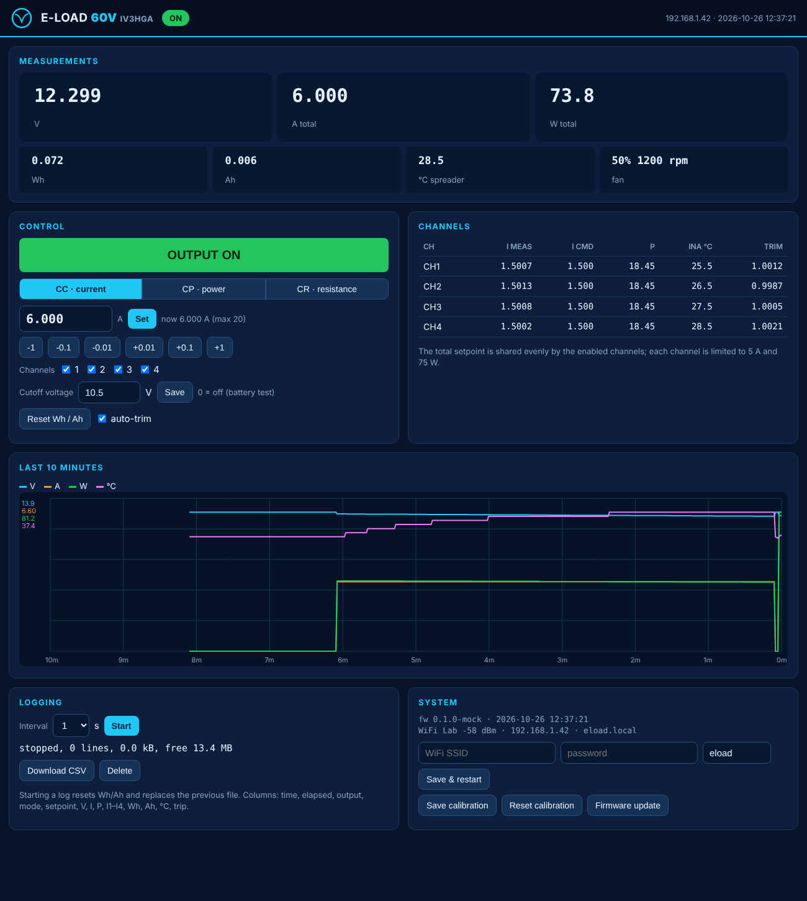

# eload-60v firmware

Firmware for the Wemos LOLIN **D1 mini Pro** (ESP8266) that controls the 4-channel electronic load: measurement, constant current / power / resistance, protections, front-panel OLED and encoder, data logging and a web interface.

> **Status: v0.1.0 — compiles and the control math passes its unit tests, but it has not run on real hardware yet.** Bring the board up with a current-limited supply and no DUT first (see *Bring-up*).



## Features

- **Modes**: CC (A), CP (W), CR (Ω). The total setpoint is shared evenly by the enabled channels. Each channel is limited to 5 A and 75 W, so above 15 V the load is power-limited.
- **Safety**:
  - The load is off at boot, and the hardware clamp holds it off until OUTPUT is pressed. It never starts by itself.
  - The INA228 ALERTs are programmed as hardware limits: 63 V bus, 5.25 A per channel, 80 W per channel. They are latched and act on ARM directly.
  - Firmware checks: V > 62 V, spreader > 85 °C, and the battery cutoff voltage.
  - The ARM read-back detects a hardware trip, and the firmware reports its cause (OVP, OCP, OPP, OTP).
  - During a firmware update the output is forced off.
- **Measurement**: 20-bit INA228 per channel. The firmware reports bus voltage, current, power, energy (Wh) and charge (Ah) from the on-chip accumulators, plus die temperatures and the spreader NTC.
- **Keep-alive**: 10 mA per channel while the output is on, so steps start in the linear region (see the loop analysis in the slides).
- **Auto-trim**: a slow closed-loop gain trim makes the setpoint match the INA228 reading (±5 % range). Save it with *Save calibration*.
- **Fan**: 25 kHz PWM driven by spreader temperature and dissipated power, with RPM measured from the tach.
- **Front panel**:
  - The OLED shows a boot splash with the logo and the IP address, then V / I / P, one line per channel, and the setpoint with an edit cursor.
  - Encoder: turning changes the setpoint; a short push moves the cursor to the next digit (vernier); a long push (0.7 s) changes the mode while the output is off.
  - OUTPUT button: toggles the output. After a trip, the first press only acknowledges it. The LED shows the output state.
- **Logging**:
  - A 10-minute RAM history (1 s) feeds the web chart.
  - CSV logging to the 14 MB LittleFS, at 1 to 60 s per line (about 64 hours at 1 s). Download it from the page.
- **Web**:
  - Single page served gzipped from flash, no external resources (works on the setup access point).
  - Live readings, controls, channel table, chart, logging, WiFi setup, calibration.
  - OTA update at `/update`, or with ArduinoOTA / `espota.py`. `http://eload.local` via mDNS.

## Building

**Arduino IDE / arduino-cli**:
- Board: *LOLIN(WEMOS) D1 mini Pro*, from the ESP8266 core 3.1.x.
- Flash Size: *16MB (FS:14MB OTA:~1019KB)*.
- Library: **U8g2**.
- Open `eload/eload.ino`. After editing `web/index.html`, run `python3 tools/embed_web.py`.

**Command line** (what is used to build the release binary): `build.sh` uses [makeEspArduino](https://github.com/plerup/makeEspArduino):

```
git clone --depth 1 --branch 3.1.2 --recurse-submodules https://github.com/esp8266/Arduino.git ~/esp/esp8266
(cd ~/esp/esp8266/tools && python3 get.py)
git clone --depth 1 https://github.com/plerup/makeEspArduino.git ~/esp/makeEspArduino
git clone --depth 1 https://github.com/olikraus/U8g2_Arduino.git ~/esp/libs/U8g2_Arduino
./build.sh              # -> /tmp/eload_build/eload.bin
./build.sh flash        # upload over USB (DUT and fan disconnected, see below)
```

A prebuilt image is in `bin/`. Memory use: 420 kB flash, 39 kB of 80 kB RAM.

**Display**: the default is the 2.42″ SSD1309. For a 1.3″ SH1106 module, add `-DDISPLAY_SH1106` (`./build.sh BUILD_EXTRA_FLAGS=-DDISPLAY_SH1106`).

## First start

1. With no WiFi configured, the load starts an access point **ELOAD-xxxxxx** (password `eload1234`). Connect to it and open `http://192.168.4.1`.
2. Under *System*, enter the SSID and password and press *Save & restart*. The new IP is shown on the OLED at boot and the page is also at `http://eload.local`. The clock syncs by NTP (Europe/Rome).
3. If the network is not reachable, the access point comes back after 15 s.

## Bring-up (recommended order)

1. Program the module **out of the board** or with the board unpowered from 12 V. The Wemos USB is **not isolated** and the fan tach shares the RX pin.
2. Plug the module in, power the 12 V input with no DUT, and check the serial log (115200 baud, TX only): it should report `INA228 #1..#4 ok`.
3. Connect a current-limited bench supply (5 V, 1 A limit) as DUT. Set CC 0.100 A on one channel only (channel mask), press OUTPUT, and compare the reading with a multimeter.
4. Step 0.1 → 0.2 A and look at the shunt voltage on a scope: there should be no ringing (see the loop slides).
5. Increase voltage and current gradually and check the fan and temperatures. Verify the OTP with a heat gun on the NTC.

## HTTP API

| Method | Path | Parameters | Notes |
|---|---|---|---|
| GET | `/api/status` | — | All readings and settings as JSON |
| GET | `/api/history` | — | Last 600 s: `[V×100, mA, W×10, °C]` |
| POST | `/api/set` | `out=0/1`, `mode=CC/CP/CR`, `set=<A/W/Ω>`, `mask=0..15`, `vcut=<V>`, `trim=0/1`, `reset=1`, `clear=1`, `save=1` | Mode can change only with the output off |
| POST | `/api/log` | `action=start&interval=<s>`, `stop`, `clear` | Start replaces the file and resets Wh/Ah |
| GET | `/log.csv` | — | CSV download (a snapshot; logging continues) |
| POST | `/api/wifi` | `ssid`, `pass`, `host` | Saves and restarts |
| POST | `/api/cal` | `action=save` / `reset` | Per-channel gain from auto-trim |
| GET/POST | `/update` | firmware `.bin` | OTA, output forced off |

Example: `curl -d "mode=CC" -d "set=2.5" -d "out=1" http://eload.local/api/set`.

## Development without hardware

- `test/test_control.cpp`: unit tests of the control math (limits, distribution, DAC codes, NTC, fan, trim).
  `g++ -std=c++17 -I eload test/test_control.cpp && ./a.out`
- `test/mock_server.py`: serves `web/index.html` with the same API, simulating a 12.6 V battery. Run `python3 test/mock_server.py 8080` and open `http://localhost:8080`.

## Source layout

| File | Content |
|---|---|
| `config.h` | pins, addresses, limits, timing |
| `control.h` | pure control math (host-tested) |
| `ina228.*`, `dac8565.*` | drivers |
| `load.*` | measurement, setpoints, protections, fan |
| `panel.*`, `logo_xbm.h` | OLED, encoder, buttons, splash logo |
| `logger.*` | RAM history and CSV logging |
| `web.*`, `webpage.h` | WiFi, HTTP API, OTA; gzipped page generated from `web/index.html` |
| `settings.*` | persistent settings in LittleFS |

Hardware details to double-check on the first board: the DAC8565 reference-enable command (`0x01 1000`), and the INA228 limit registers (SOVL 5 µV/LSB, BOVL 3.125 mV/LSB, PWR_LIMIT 256 × power LSB).
